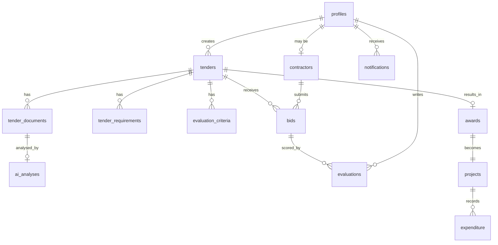

# Data model

Target SQL: [schema.sql](./schema.sql). Shared TypeScript enums: `packages/shared`.

## Status machines

Tender:

```
draft → published → closed → evaluating → awarded → completed → archived
         ↘ archived at several points (see TENDER_TRANSITIONS)
```

Bid: `draft → submitted → under_review → accepted | rejected` (or `withdrawn` from submitted).

AI analysis: `pending → processing → needs_review → approved | corrected`.

Until `approved` or `corrected`, extracted dates/requirements **must not** drive closing-date validation or public listing.

## Core entities



| Table | Purpose |
| --- | --- |
| `profiles` | 1:1 with `auth.users`. Role, display name. |
| `contractors` | Company profile and compliance flags for contractor accounts. |
| `tenders` | Title, category, budget, dates, status, department. |
| `tender_documents` | Storage path, mime, version, kind. |
| `tender_requirements` | Mandatory / optional requirements (human-approved). |
| `evaluation_criteria` | Weighted criteria (human-approved). |
| `ai_analyses` | Advisory extraction; review state. |
| `bids` | Contractor submission against a published tender. |
| `bid_documents` | Bid attachments. |
| `bid_requirement_responses` | Per-requirement answers. |
| `evaluator_assignments` | Which evaluators may see which tenders/bids. |
| `evaluations` | Scores, comments, compliance decision. |
| `awards` | Winning bid + award record. |
| `projects` | Post-award progress. |
| `expenditure` | Spend lines for reporting and the public portal. |
| `notifications` | In-app notification records (channels fan out from the worker). |
| `audit_logs` | Immutable-ish trail of tender/eval/award mutations. |

## Identity rule

- Internal staff and contractors: authenticated `profiles` row.
- Public citizens: `anon`. They only `SELECT` transparency views (`awarded_tenders_public`, etc.), never base tables with bid or evaluation data.

## What stays out of the first migration

Meilisearch indexes, map geometry, SMS provider state, Sentry. Add them when Phase 4 actually needs them. Do not invent columns "just in case".
