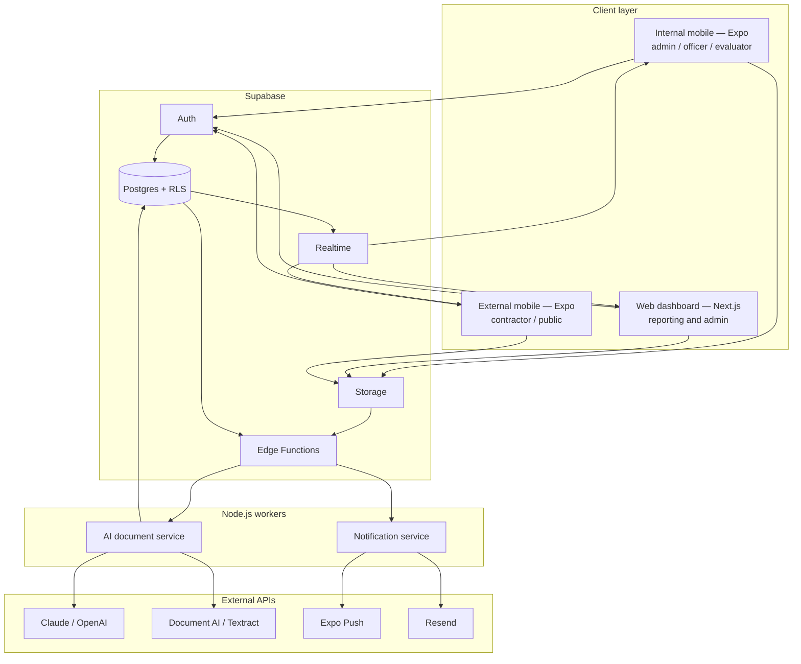

# Architecture overview

Single source of truth: **Supabase Postgres**. Three clients, two Node.js workers, no custom REST CRUD layer. Clients talk to Supabase through the generated API. RLS is the real authorisation boundary.

## Layers

| Layer | Lives in | Owns |
| --- | --- | --- |
| Client | `apps/mobile-internal`, `apps/mobile-external`, `apps/web` | Screens, navigation, role-gated UI |
| Domain | `packages/shared` | Roles, statuses, transitions — imported, never copied |
| Data | `supabase/` + `docs/architecture/schema.sql` | Tables, RLS, storage buckets, triggers |
| Workers | `apps/services` | AI extraction, notifications, scheduled reminders |
| Glue | Supabase Edge Functions | React to storage/db events; invoke workers |

## Non-negotiables

1. **Postgres is canonical.** Clients do not keep a second procurement database.
2. **RLS on every exposed table.** UI hiding is not security.
3. **Roles live in `app_metadata` and `profiles.role`, never in `user_metadata`.** `user_metadata` is user-editable.
4. **AI never writes official tender fields.** It writes a review row. A procurement officer must approve or correct before values become operational.
5. **Public portal is a projection.** Only awarded / published-for-transparency columns. Bids, scores and evaluator comments stay internal.
6. **Service role key never ships in a client.** Mobile and Next.js browser bundles use the publishable key only.
7. **Status changes go through `canTransition` in `@tender/shared` and a matching Postgres check.** No free-form status strings.

## Request path (example: create tender)

1. Officer signs in (Supabase Auth) on the internal app.
2. App inserts into `tenders` as `draft` (RLS: procurement_officer / super_admin).
3. App uploads files to Storage bucket `tender-documents`.
4. Edge Function on object create calls the AI worker.
5. Worker writes `ai_analyses` with `needs_review`.
6. Realtime pushes the pending summary to the officer.
7. Officer approves → tender fields and requirements update; status may become `published`.

Full service list: [services.md](./services.md). Client split: [clients.md](./clients.md). Security: [security.md](./security.md).
